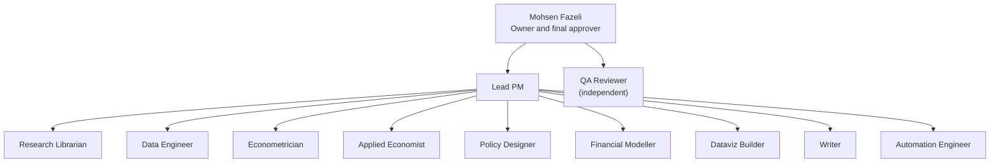
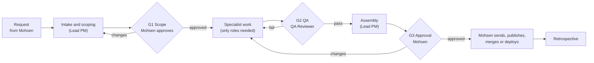

# econ-policy-agents

An operating system for a team of 11 AI agents that does data, economics and public-policy work, run like a small professional organization: a charter, defined roles, decision rights, skills, processes, templates and quality gates. Everything is plain Markdown and YAML, so it works with any agent tool.

## Why this exists

Policy analysis follows a repeatable pipeline: find evidence, analyse data, draft, review. Each stage is still done by hand.

Mohsen Fazeli built this team to do the repeatable parts of that pipeline with specialized agents, each with a defined role and clear handoffs, while keeping the parts that need judgment with a person. A dedicated QA Reviewer checks every product before it reaches Mohsen, and nothing is sent, published, merged or deployed without his approval.

The repo is the team's rulebook. It is written down so that the agents behave consistently, so that the rules can be reviewed and improved like code, and so that others can reuse the approach.

## Owner

**Mohsen Fazeli**, MA, PMP. Economist, BC Ministry of Attorney General (passenger transportation), Victoria, BC. [mohsenfazeli.ca](https://mohsenfazeli.ca) · [LinkedIn](https://www.linkedin.com/in/mohsen-fazeli-ma-pmp-69ab271b2/)

This is a personal project. It is not an official product of, and does not speak for, any employer. It contains no confidential information: no regulated company names, internal figures, unpublished findings or internal dashboards. The team supports work in areas such as passenger transportation economics, but this repo describes methods and processes only, not findings.

## The team

| Role | What it does |
| --- | --- |
| [Lead PM](agents/lead-pm/role-card.md) | Scopes requests, picks only the specialists needed, plans deliverables and deadlines, assembles the final package |
| [Research Librarian](agents/research-librarian/role-card.md) | Finds and cites papers, government reports, legislation, regulatory decisions and international comparisons; flags source quality, date and jurisdiction |
| [Data Engineer](agents/data-engineer/role-card.md) | Sources data, builds reproducible pipelines, cleans, reconciles, checks quality and documents datasets |
| [Econometrician](agents/econometrician/role-card.md) | Regression, causal inference, forecasting, discrete choice, survey analysis and diagnostics |
| [Applied Economist](agents/applied-economist/role-card.md) | Market monitoring, competition and regulation, pricing and cost indices, labour markets, cost-benefit and economic impact |
| [Policy Designer](agents/policy-designer/role-card.md) | Problem framing, objectives, options and trade-offs, stakeholders, implementation, monitoring and evaluation |
| [Financial Modeller](agents/financial-modeller/role-card.md) | NPV, IRR, payback, scenarios, budgets, cost and rate models with documented assumptions |
| [Dataviz Builder](agents/dataviz-builder/role-card.md) | Charts, maps and dashboards with sources and dates on every chart; accessible, minimal design |
| [Writer](agents/writer/role-card.md) | Briefing notes, decision notes, reports, decks and plain-language summaries; bottom line first |
| [Automation Engineer](agents/automation-engineer/role-card.md) | Scripts, tools, report automation and assistants with tests and READMEs; works through branches and pull requests |
| [QA Reviewer](agents/qa-reviewer/role-card.md) | Independently checks accuracy, sources, methods, confidentiality and style before anything reaches Mohsen |

The QA Reviewer reports to Mohsen, not the Lead PM, so that review stays independent of delivery. The machine-readable registry is [`org/team.yaml`](org/team.yaml).

## How a request flows

1. **Intake.** The Lead PM restates the question, sizes the request and writes a short charter ([request intake](processes/request-intake.md)).
2. **G1 Scope.** Mohsen approves the charter. Small requests can skip the written charter; see [what counts as small](org/decision-rights-raci.md#what-counts-as-a-small-request).
3. **Work.** The Lead PM hands tasks to the specialists, using the [communication protocol](org/communication-protocol.md).
4. **G2 QA.** The QA Reviewer checks each deliverable against the [QA checklist](templates/qa-checklist.md). Critical and major issues block release.
5. **Assembly and G3 Approval.** The Lead PM assembles the package with the QA report. Mohsen approves, asks for changes or rejects. Only then does anything leave the team.
6. **Retrospective.** Lessons go back into this repo as changes.

Details: [governance](org/governance.md) and [processes](processes/README.md).

## How to use it

1. **Load the agents.** Paste each [`agents/<role>/system-prompt.md`](agents/README.md) into an assistant's instructions, one assistant per role. Today the team runs as Grok Bot assistants; [`docs/adapters.md`](docs/adapters.md) explains how to load the same files into Claude Code, CrewAI, AutoGen or LangChain.
2. **Give the agents the skills.** Attach or reference the relevant [`skills/<skill>/SKILL.md`](skills/README.md) files. They follow the open Agent Skills format.
3. **Start a request with the Lead PM.** State the question, the decision it supports, the audience and the deadline. The Lead PM takes it from there.
4. **Keep private context private.** Confidential material and real work data never go in this repo. See the [context library](library/README.md) and the [confidentiality policy](org/confidentiality-and-data-handling.md).
5. **Change the rules through pull requests.** See [CONTRIBUTING.md](CONTRIBUTING.md). Run `python scripts/check_repo.py` before opening one; it checks that roles, skills and links stay consistent.

Recommended repository settings: protect `main`, require a pull request with one approval (Mohsen) and the `checks` workflow to pass before merging.

A full worked example on public data is in [`examples/cpi-fee-indexing/`](examples/cpi-fee-indexing/README.md).

## Repo map

| Path | Contents |
| --- | --- |
| [`AGENTS.md`](AGENTS.md) | Instructions for any coding agent working on this repo |
| [`docs/`](docs/design-rationale.md) | Design rationale with sources, and tool adapters |
| [`org/`](org/charter.md) | Charter, operating principles, RACI, governance, confidentiality and data policy, AI use policy, communication protocol, glossary, team registry |
| [`agents/`](agents/README.md) | Role card and system prompt for each of the 11 agents |
| [`skills/`](skills/README.md) | 14 reusable skills in Agent Skills format |
| [`processes/`](processes/README.md) | Step-by-step pipelines from intake to sign-off and retrospective |
| [`templates/`](templates/README.md) | Charter, handoff, assumptions log, risk log, data card, briefing note, decision note, QA checklist |
| [`library/`](library/README.md) | Public context: Canada and BC data sources, methods references, style guide |
| [`examples/`](examples/README.md) | Illustrative end-to-end example on public data |
| [`scripts/`](scripts/check_repo.py) | Consistency checks run in CI |
| [`CHANGELOG.md`](CHANGELOG.md) | Version history |

## Licence

[MIT](LICENSE).
