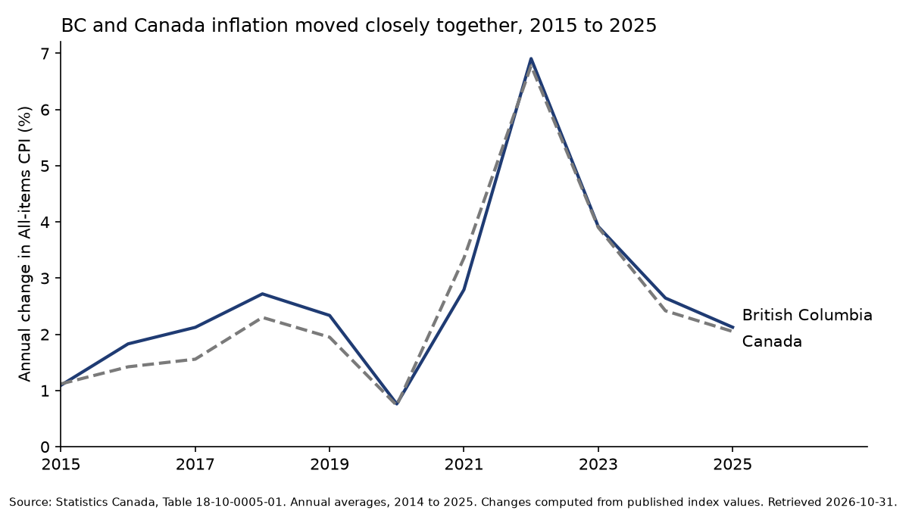

# Worked example: should a fixed fee be indexed to inflation?

> **Illustrative walkthrough.** This example shows how the team handles a request from intake to approval. The question is hypothetical and uses only public data. The "fee" is an imaginary $100 flat fee; it does not describe any real program, regulator or company. All figures come from Statistics Canada Table 18-10-0005-01 as retrieved on 2026-10-31 by [`fetch_cpi.py`](fetch_cpi.py), or are simple arithmetic on those figures. Messages are written in the team's formats to show the flow; they are examples, not records of a real request. Mohsen's approval is shown as a placeholder because this example has not been through a real approval.

**Request ID:** `REQ-2026-000` (reserved for examples) · **Label:** Public

## The request

> "Suppose a BC program has charged a flat $100 fee since 2015. Prepare a short briefing note on how much inflation has eroded it, whether it should be indexed, and whether BC or Canada CPI is the better index."

## 1. Intake (Lead PM)

Skill: [project-intake-scoping](../../skills/project-intake-scoping/SKILL.md)

The Lead PM restates the request, identifies the essentials and sizes it as **standard** (several specialists, one written product plus a chart).

**Charter summary** (full template: [project charter](../../templates/project-charter.md)):

| Field | Entry |
| --- | --- |
| Question | How much has inflation eroded a $100 fee set in 2015, and what are the options for indexing it? |
| Decision supported | Whether to index a hypothetical flat fee, and to which index |
| Audience | A senior reader familiar with the program but not with price statistics |
| Deliverables | D1: two-page briefing note. D2: one chart. |
| In scope | All-items CPI, Canada and BC, 2015 to 2025, annual averages; indexing options |
| Out of scope | Any real fee or program; cost-of-service analysis; legal authority to change fees |
| Label | Public |

**Team:**

| Role | Why involved |
| --- | --- |
| Research Librarian | CPI definitions and how annual averages are published |
| Data Engineer | Retrieve and validate the CPI series |
| Applied Economist | Interpret price indices; compute erosion and indexed values |
| Policy Designer | Frame options and trade-offs |
| Dataviz Builder | One chart |
| Writer | Briefing note |
| QA Reviewer | Independent review (always) |

**Not involved:** Econometrician (no estimation or forecasting needed), Financial Modeller (the calculation is a single ratio, handled by the Applied Economist), Automation Engineer (no tool to build; the Data Engineer's script is enough).

**Scope gate (G1):** The charter goes to Mohsen. `[PLACEHOLDER: in a real run, Mohsen's approval message is recorded here]`

## 2. Handoffs (Lead PM)

Example handoff to the Data Engineer, using the [handoff template](../../templates/handoff-message.md):

```text
[REQ-2026-000-T2] HANDOFF
From: Lead PM
To: Data Engineer
Date: 2026-10-31
Label: Public

Task: Retrieve annual average All-items CPI for Canada and BC, 2014 to 2025, and validate it.
Why: Charter question 1 (erosion of a $100 fee since 2015) and the chart (D2).
Inputs: Charter; library/data-sources/canada-bc.md (Table 18-10-0005-01).
Expected output: Script, data documentation card, validation results. Skill: data-sourcing-validation.
Done when:
  - Script retrieves the table from the Statistics Canada WDS and reruns cleanly.
  - Vector IDs, units, reference period and retrieval date are recorded.
  - At least one value reconciled to the published table.
Constraints: Public data only. No hand-typed values.
Due: 2026-10-31
Next: Applied Economist and Dataviz Builder.
```

The Research Librarian, Applied Economist, Policy Designer, Dataviz Builder and Writer receive similar handoffs. The Research Librarian and Data Engineer work in parallel.

## 3. Evidence (Research Librarian)

Skill: [literature-review](../../skills/literature-review/SKILL.md)

The Research Librarian points the team to the primary sources:

| ID | Source | Type | Use |
| --- | --- | --- | --- |
| S1 | Statistics Canada, [Consumer Price Index, annual average, not seasonally adjusted](https://www150.statcan.gc.ca/t1/tbl1/en/tv.action?pid=1810000501), Table 18-10-0005-01 | Official statistics | The index values |
| S2 | Statistics Canada, [The Canadian Consumer Price Index Reference Paper](https://www150.statcan.gc.ca/n1/en/catalogue/62-553-X) (62-553-X) | Methodology | What the CPI measures, its uses and interpretation, and how it is calculated |

Return note: the annual average is published only after the December CPI is released, so any fee indexed on annual averages lags prices by roughly a year. The reference paper should be read for what the CPI does and does not measure before the note describes it.

## 4. Data (Data Engineer)

Skills: [data-sourcing-validation](../../skills/data-sourcing-validation/SKILL.md), [data-quality-audit](../../skills/data-quality-audit/SKILL.md)

The pipeline is [`fetch_cpi.py`](fetch_cpi.py). It calls the Statistics Canada Web Data Service, downloads the full table, and filters to All-items CPI for Canada (vector v41693271) and British Columbia (vector v41694760). It stops if the unit of measure is not `2002=100` or any year is missing. To rerun:

```bash
python examples/cpi-fee-indexing/fetch_cpi.py          # tables only, standard library
python examples/cpi-fee-indexing/fetch_cpi.py --chart  # also draws the chart (needs matplotlib)
```

**Data documentation card (summary):**

| Field | Entry |
| --- | --- |
| Producer | Statistics Canada |
| Table | 18-10-0005-01, Consumer Price Index, annual average, not seasonally adjusted |
| Series | All-items; Canada (v41693271), British Columbia (v41694760) |
| Units | Index, 2002=100 |
| Period used | 2014 to 2025 (2014 is needed for the 2015 annual change) |
| Retrieved | 2026-10-31 |
| Licence | [Statistics Canada Open Licence](https://www.statcan.gc.ca/en/terms-conditions/open-licence) |
| Audit result | Fit for purpose, with one caveat: annual changes computed from index values rounded to one decimal can differ slightly from rates Statistics Canada publishes |

**Values retrieved** (S1):

| Year | CPI Canada | CPI BC |
| --- | --- | --- |
| 2014 | 125.2 | 118.9 |
| 2015 | 126.6 | 120.2 |
| 2016 | 128.4 | 122.4 |
| 2017 | 130.4 | 125.0 |
| 2018 | 133.4 | 128.4 |
| 2019 | 136.0 | 131.4 |
| 2020 | 137.0 | 132.4 |
| 2021 | 141.6 | 136.1 |
| 2022 | 151.2 | 145.5 |
| 2023 | 157.1 | 151.2 |
| 2024 | 160.9 | 155.2 |
| 2025 | 164.2 | 158.5 |

## 5. Analysis (Applied Economist)

Skill: [market-monitoring](../../skills/market-monitoring/SKILL.md) (price-index steps)

Calculations, all from the values above:

- **Annual change** = index in year ÷ index in previous year − 1.
- **Indexed fee** in year *t* = $100 × CPI*t* ÷ CPI2015.
- **Real value of the unindexed fee** in 2015 dollars = $100 × CPI2015 ÷ CPI*t*.

| Year | Change Canada (%) | Change BC (%) | $100 indexed to Canada CPI | $100 indexed to BC CPI | Unindexed $100 in 2015 dollars (BC CPI) |
| --- | --- | --- | --- | --- | --- |
| 2015 | 1.1 | 1.1 | 100.00 | 100.00 | 100.00 |
| 2016 | 1.4 | 1.8 | 101.42 | 101.83 | 98.20 |
| 2017 | 1.6 | 2.1 | 103.00 | 103.99 | 96.16 |
| 2018 | 2.3 | 2.7 | 105.37 | 106.82 | 93.61 |
| 2019 | 1.9 | 2.3 | 107.42 | 109.32 | 91.48 |
| 2020 | 0.7 | 0.8 | 108.21 | 110.15 | 90.79 |
| 2021 | 3.4 | 2.8 | 111.85 | 113.23 | 88.32 |
| 2022 | 6.8 | 6.9 | 119.43 | 121.05 | 82.61 |
| 2023 | 3.9 | 3.9 | 124.09 | 125.79 | 79.50 |
| 2024 | 2.4 | 2.6 | 127.09 | 129.12 | 77.45 |
| 2025 | 2.1 | 2.1 | 129.70 | 131.86 | 75.84 |

Annual changes are computed from rounded index values (see the caveat above).

**Interpretation:**

- From 2015 to 2025, the BC All-items CPI rose 31.9% and the Canada All-items CPI rose 29.7%.
- A $100 fee left unchanged since 2015 was worth about $75.84 in 2015 dollars by 2025, measured with BC CPI: a loss of about a quarter of its real value.
- Indexing to BC CPI would have brought the fee to $131.86 in 2025; indexing to Canada CPI, to $129.70. The difference between the two indices over ten years is about $2 on a $100 fee.
- Most of the erosion happened in 2021 to 2023, when annual inflation was well above the rates of the late 2010s.
- The CPI measures changes in consumer prices. It does not measure changes in the cost of delivering a particular service. If the fee is meant to recover costs, a cost index for that service may fit better. This is a limitation to flag, not something this example analyses.

## 6. Options (Policy Designer)

Skill: [policy-options-analysis](../../skills/policy-options-analysis/SKILL.md)

Objective (for the example): keep the fee's real value roughly stable over time, in a way that is predictable for payers and simple to administer.

| Option | Description | Keeps real value | Predictability for payers | Administrative simplicity | Equity notes |
| --- | --- | --- | --- | --- | --- |
| 1. Status quo | Fee stays at $100 nominal | Low: real value fell to about $76 (2015 dollars) by 2025 | High in nominal terms | High | Payers benefit from erosion; the program's real revenue falls |
| 2. Annual indexing to BC CPI | Fee changes each year by the previous year's BC All-items CPI annual change | High, with about a one-year lag | Medium: changes are small and rule-based, but vary year to year | Medium: one calculation a year | Large jumps in high-inflation years (BC: 6.9% in 2022) |
| 3. Annual indexing with a cap | As option 2, but each annual increase capped at a set percentage | Medium: protects payers in high-inflation years, at the cost of some erosion | High | Medium | Shifts some inflation risk from payers to the program |
| 4. Periodic review | Fee reviewed and reset every few years | Medium: erodes between reviews, then jumps | Low: larger, less frequent changes | Low to medium: needs a decision each time | Larger one-time increases may be harder for some payers |

On the choice of index: over 2015 to 2025 the BC and Canada series moved closely (chart below), and the ten-year difference on a $100 fee is about $2. The BC index matches where the fee is paid; the Canada index is the more familiar headline figure. Either is defensible; the main decision is whether to index at all, and whether to cap.

Legal authority to change or index the fee is out of scope and would need legal review in a real case.

## 7. Chart (Dataviz Builder)

Skill: [chart-dashboard-build](../../skills/chart-dashboard-build/SKILL.md)



Alt text is in the image tag. The chart is drawn by `fetch_cpi.py --chart` from the retrieved data; no values are typed in.

## 8. Write-up (Writer)

Skill: [briefing-note](../../skills/briefing-note/SKILL.md)

Result: [`briefing-note.md`](briefing-note.md).

## 9. QA (QA Reviewer)

Skill: [qa-review](../../skills/qa-review/SKILL.md)

Result: [`qa-report.md`](qa-report.md). The issues in that report are real points about this example's data and drafts.

## 10. Approval (Mohsen)

`[PLACEHOLDER: in a real run, the Lead PM sends Mohsen the briefing note, chart and QA report, and records his explicit approval or requested changes here. This example has not been approved for any use beyond illustration.]`

## 11. Retrospective (Lead PM)

Process: [retrospective](../../processes/retrospective.md)

Lessons this example surfaced, and the repo changes they led to:

| Lesson | Change |
| --- | --- |
| Percentage changes computed from rounded index values can differ slightly from published rates | Added as a pitfall in the [data-sourcing-validation skill](../../skills/data-sourcing-validation/SKILL.md) and as a rule in the [style guide](../../library/style-guide.md#3-numbers-dates-and-units) |
| CPI is not a cost-of-service index | Kept as an explicit limitation in the note; a cost-index question would be a separate request |
