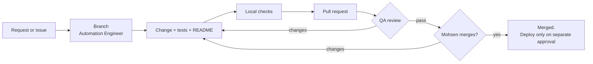

# Code change via pull request

For any change to code, tools, automation, AI assistants, prompts, skills, templates or this repo.

**Accountable:** Automation Engineer for the change; QA Reviewer for the review; Mohsen for the merge.

## Steps

1. **Start from an approved need.** A handoff from the Lead PM, or an issue Mohsen has accepted.
2. **Create a branch** from `main` with a descriptive name (for example, `fix-cpi-pipeline-units`).
3. **Make the change.** Keep it focused: one logical change per pull request.
4. **Add or update tests** for code changes. For prompts and skills, run the repo check script.
5. **Update documentation:** README, the relevant role card or skill, and [`CHANGELOG.md`](../CHANGELOG.md) under "Unreleased".
6. **Run checks locally:** tests, `python scripts/check_repo.py`, and a search for secrets and data files.
7. **Commit** with clear messages. The [Conventional Commits](https://www.conventionalcommits.org/en/v1.0.0/) style (`feat:`, `fix:`, `docs:`) is recommended.
8. **Push the branch and open a pull request** using the [pull request template](../.github/pull_request_template.md): what changed, why, how it was tested, risks, and rollback.
9. **QA review.** The QA Reviewer reviews against the [qa-review skill](../skills/qa-review/SKILL.md), including the code items.
10. **Mohsen reviews and merges.** No agent merges.
11. **Deployment** of any tool is a separate action that needs its own explicit approval.

## Rules

- Never push directly to `main`. Recommended: turn on [branch protection](https://docs.github.com/en/repositories/configuring-branches-and-merges-in-your-repository/managing-protected-branches/about-protected-branches) for `main`, requiring a pull request and a passing check.
- Never commit secrets, credentials, internal URLs, or data or outputs from real work. The `.gitignore` blocks common data formats; do not override it.
- Never disable a test or check to make a build pass.
- Never rewrite shared history (force-push to `main`, or rewrite merged commits) without Mohsen's approval.
- Changes to the non-negotiable rules, the governance document or the confidentiality policy need Mohsen's explicit sign-off in the pull request, not only a merge.
