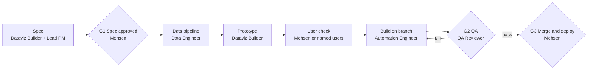

# Dashboard build

For new dashboards and material changes to existing ones.

**Accountable:** Dataviz Builder for design; Automation Engineer for code and deployment readiness; Mohsen for deployment.

## Stages

| # | Stage | Owner | Output | Exit criterion |
| --- | --- | --- | --- | --- |
| 1 | Specification | Dataviz Builder, with Lead PM | Users, questions, data sources, refresh, label, tool | Tool confirmed as approved for the data's label |
| 2 | Spec approval (G1) | Mohsen | Approval | Explicit approval |
| 3 | Data pipeline | Data Engineer | Scripted pipeline, data card, audit | Pipeline reruns cleanly |
| 4 | Prototype | Dataviz Builder | Static mock-up or prototype, chart notes | Every view answers a listed question |
| 5 | User check | Mohsen or named users | Feedback | Feedback recorded |
| 6 | Build | Automation Engineer | Branch, code, tests, README | Tests pass |
| 7 | QA (G2) | QA Reviewer | QA report covering data, charts, accessibility, code | PASS |
| 8 | Merge and deploy (G3) | Mohsen | Merge, deployment | Explicit approval; Mohsen or an agent acting on that specific approval performs it |

## Dashboard specification checklist

- [ ] Users and the decisions or questions the dashboard supports.
- [ ] Each view, and the question it answers.
- [ ] Data sources, with table or series IDs.
- [ ] Refresh frequency and who is responsible for it.
- [ ] Handling label of the data, and confirmation the tool is approved for it.
- [ ] Accessibility requirements.
- [ ] Where it will be hosted, and who can see it.
- [ ] How it will be retired or reviewed.

## Public versus private

Dashboards built on real work data never appear in this repo, including as screenshots. A public demo dashboard may be built only on public data, and is labelled as a demo.
