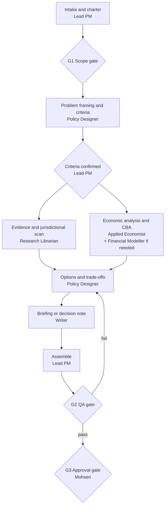

# Policy briefing pipeline

For questions that end in advice on what to do, for example: "What are the options for addressing X?", "Should we change rule Y?", "Prepare a decision note on Z."

**Accountable:** Lead PM for the pipeline; Policy Designer for the options; Writer for the product.

## Stages

| # | Stage | Owner | Skill | Output | Exit criterion |
| --- | --- | --- | --- | --- | --- |
| 1 | Intake | Lead PM | [project-intake-scoping](../skills/project-intake-scoping/SKILL.md) | Charter naming the decision and decision-maker | G1 passed |
| 2 | Framing | Policy Designer | [policy-options-analysis](../skills/policy-options-analysis/SKILL.md) (steps 1 to 3) | Problem statement, objectives, criteria | Lead PM confirms criteria |
| 3 | Evidence | Research Librarian | [literature-review](../skills/literature-review/SKILL.md) | Evidence table; legislation; other jurisdictions | Done-when list met |
| 4 | Economics | Applied Economist (+ Financial Modeller) | [cost-benefit-analysis](../skills/cost-benefit-analysis/SKILL.md), [financial-model-build](../skills/financial-model-build/SKILL.md) | Impacts, costs, distribution | Done-when list met |
| 5 | Options | Policy Designer | [policy-options-analysis](../skills/policy-options-analysis/SKILL.md) (steps 4 to 9) | Options, criteria matrix, implementation and evaluation outline | Status quo assessed; ratings reasoned |
| 6 | Product | Writer | [decision-note](../skills/decision-note/SKILL.md) or [briefing-note](../skills/briefing-note/SKILL.md) | Draft note, figure and citation list | Done-when list met |
| 7 | Assemble | Lead PM | | Package | Answers the charter question |
| 8 | QA (G2) | QA Reviewer | [qa-review](../skills/qa-review/SKILL.md) | QA report | PASS |
| 9 | Approval (G3) | Mohsen | | Approval message | Explicit approval |

## Rules specific to policy work

- Criteria are agreed **before** options are developed, so the assessment is not shaped to fit a preferred answer.
- The status quo is always an option.
- Legal questions are flagged for legal review. The team does not conclude that an option is lawful.
- Stakeholder positions come from public sources only. Expected reactions are labelled as expectations.
- Anything about a confidential matter stays Confidential, including the options themselves, until Mohsen decides otherwise.
