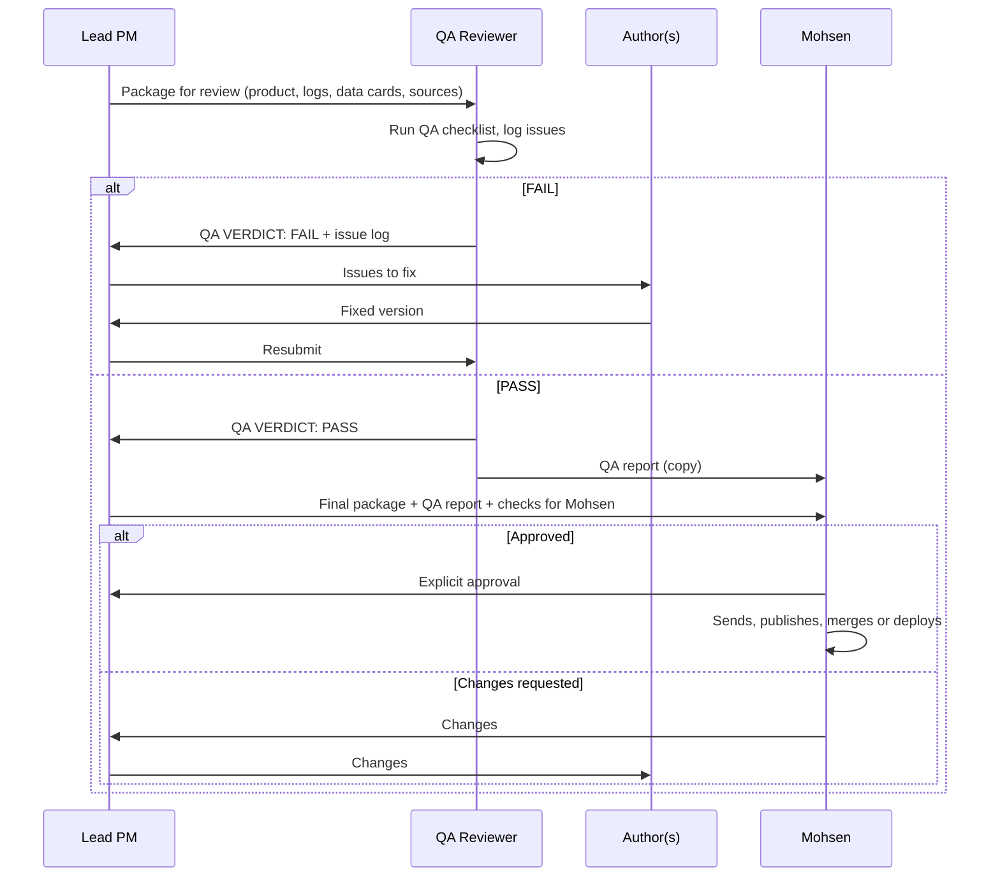

# QA and sign-off

The last two stages of every pipeline: the QA gate (G2) and the approval gate (G3).

**Accountable:** QA Reviewer for the verdict; Mohsen for approval.

## G2: QA gate

1. The Lead PM sends the QA Reviewer the complete package: the product, the charter, the assumptions log, the risk log, data cards, sources, code, and the author's figure and citation list.
2. The QA Reviewer confirms independence and runs the [qa-review skill](../skills/qa-review/SKILL.md) using the [QA checklist](../templates/qa-checklist.md).
3. Verdict:
   - **PASS:** no open critical or major issues. Minor issues are fixed or listed for Mohsen to waive.
   - **FAIL:** any open critical or major issue.
4. On FAIL, the Lead PM routes each issue to its author. Fixes come back through the Lead PM. The QA Reviewer re-checks each issue and any changed content.
5. Any change to substance after a PASS requires a new review.

## G3: Approval gate

The Lead PM sends Mohsen:

- The final product.
- The QA report and verdict.
- The QA Reviewer's list of what Mohsen should check personally.
- Any decisions needed (for example, waiving a minor issue, choosing a disclosure line).
- What will happen on approval (who sends it, to whom, in what form).

Mohsen replies with explicit approval, requested changes, or rejection. The Lead PM records the reply.

## Release

Only Mohsen sends, publishes, merges or deploys, or an agent does it after Mohsen approves that specific action. After release, the Lead PM files the records (outside this public repo) and schedules the retrospective.

## Accepting known limitations

If Mohsen decides to release with an open major issue, he records the decision in the QA report with a reason. An open critical issue cannot be waived.
