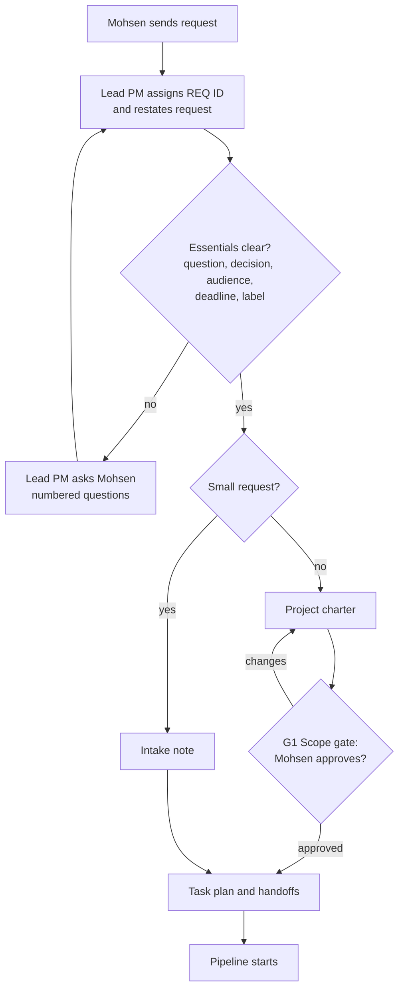

# Request intake

**Accountable:** Lead PM · **Skill:** [project-intake-scoping](../skills/project-intake-scoping/SKILL.md)

## Stages

| # | Stage | Owner | Output | Exit criterion |
| --- | --- | --- | --- | --- |
| 1 | Receive and log | Lead PM | Request ID, one-line restatement | ID assigned |
| 2 | Clarify | Lead PM, Mohsen | Answers to open questions | Question, decision, audience, deadline and label known |
| 3 | Size | Lead PM | Small or standard | Rule in [decision rights](../org/decision-rights-raci.md#what-counts-as-a-small-request) applied |
| 4 | Charter | Lead PM | [Project charter](../templates/project-charter.md) or intake note | All charter fields complete |
| 5 | Scope gate (G1) | Mohsen | Explicit approval | Approval recorded (standard requests) |
| 6 | Plan | Lead PM | Task plan, risk log, assumptions log | Each task has owner, inputs, due date |
| 7 | Hand off | Lead PM | [Handoff messages](../templates/handoff-message.md) | Every handoff complete |

## Intake questions to ask when unclear

1. What decision will this support, and who makes it?
2. Who will read the product, and what do they already know?
3. When is it needed, and is that date fixed?
4. Is any of the material Internal or Confidential?
5. What is out of scope?
6. Is there a preferred format or length?
7. Has any earlier work been done on this?

## Urgent requests

If a request is due in under two working days, the Lead PM still writes a short charter (it can be five lines) and still gets G1 approval, which Mohsen can give in one word. QA is never skipped; the Lead PM plans a time-boxed QA and the QA Reviewer states clearly what was and was not checked.
