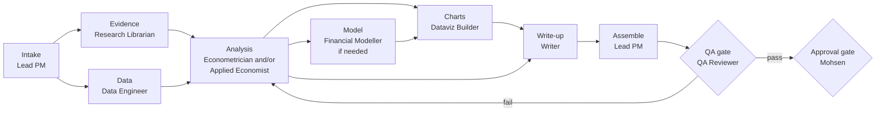

# Standard analysis pipeline

For data and economic analysis questions, for example: "How have prices in a sector changed relative to overall inflation?", "What is the effect of X on Y?", "What will demand look like over five years?"

**Accountable:** Lead PM for the pipeline; each specialist for their stage.

## Stages

| # | Stage | Owner | Skill | Output | Exit criterion |
| --- | --- | --- | --- | --- | --- |
| 1 | Intake | Lead PM | [project-intake-scoping](../skills/project-intake-scoping/SKILL.md) | Approved charter | G1 passed |
| 2 | Evidence | Research Librarian | [literature-review](../skills/literature-review/SKILL.md) | Evidence table, prior estimates, method precedents | Done-when list met |
| 3 | Data | Data Engineer | [data-sourcing-validation](../skills/data-sourcing-validation/SKILL.md), [data-quality-audit](../skills/data-quality-audit/SKILL.md) | Pipeline, data card, audit | Data rated fit for purpose (or caveats accepted by Lead PM) |
| 4 | Analysis | Econometrician and/or Applied Economist | [regression-analysis](../skills/regression-analysis/SKILL.md), [forecasting](../skills/forecasting/SKILL.md), [market-monitoring](../skills/market-monitoring/SKILL.md), [cost-benefit-analysis](../skills/cost-benefit-analysis/SKILL.md) | Results, diagnostics, interpretation | Done-when list met |
| 5 | Model (if needed) | Financial Modeller | [financial-model-build](../skills/financial-model-build/SKILL.md) | Model, guide, results | All checks pass |
| 6 | Charts | Dataviz Builder | [chart-dashboard-build](../skills/chart-dashboard-build/SKILL.md) | Charts, code, notes | Values verified against data |
| 7 | Write-up | Writer | [briefing-note](../skills/briefing-note/SKILL.md) | Draft product, figure and citation list | Done-when list met |
| 8 | Assemble | Lead PM | | Package: product, analysis, logs, data cards | Answers the charter question |
| 9 | QA (G2) | QA Reviewer | [qa-review](../skills/qa-review/SKILL.md) | QA report | PASS |
| 10 | Approval (G3) | Mohsen | | Approval message | Explicit approval |

Stages 2 and 3 can run in parallel. The Lead PM decides whether stage 4 needs the Econometrician, the Applied Economist, or both.

## Handoff points to watch

- **Data to analysis:** the analyst must receive the data card, not just the file. Breaks, revisions and suppression must be visible.
- **Analysis to writing:** the Writer receives the interpretation and limitations in plain language, not only tables.
- **Any return that changes a key assumption** goes back to the Lead PM, who checks which other stages are affected.
